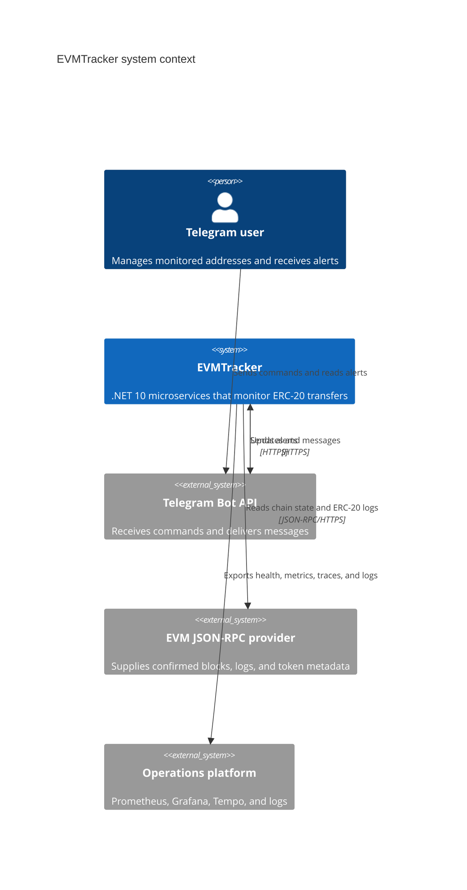
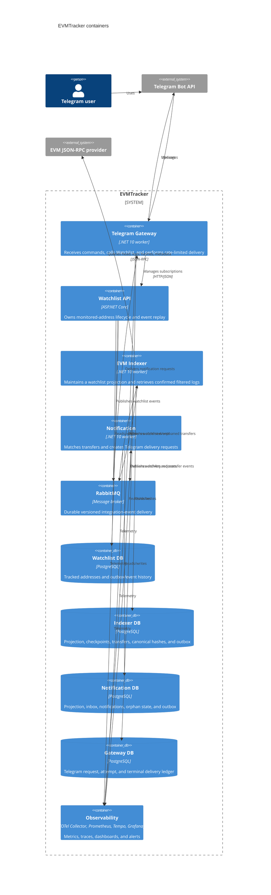
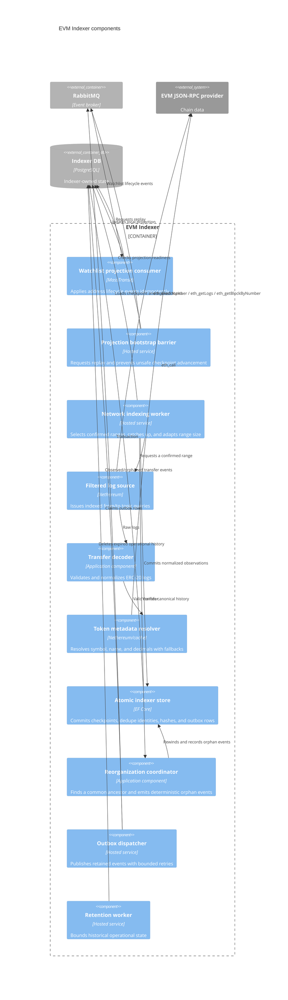

# C4 Architecture Model

These diagrams describe the implemented EVMTracker architecture. PostgreSQL cylinders represent service-owned databases; no service reads another service's data directly.

## System context

## Container view

## EVM Indexer component view

## Evidence and maintenance

- Boundary rationale: [`docs/adr/0001-microservice-boundaries.md`](../adr/0001-microservice-boundaries.md).
- Data ownership: [`docs/adr/0002-postgresql-and-data-ownership.md`](../adr/0002-postgresql-and-data-ownership.md).
- Event delivery: [`docs/adr/0003-rabbitmq-event-delivery.md`](../adr/0003-rabbitmq-event-delivery.md).
- Acquisition strategy: [`docs/adr/0004-evm-log-acquisition.md`](../adr/0004-evm-log-acquisition.md).
- HTTP and event contracts: [`docs/contracts/`](../contracts/).

Update this file whenever a deployable boundary, owned data store, or cross-service protocol changes.
